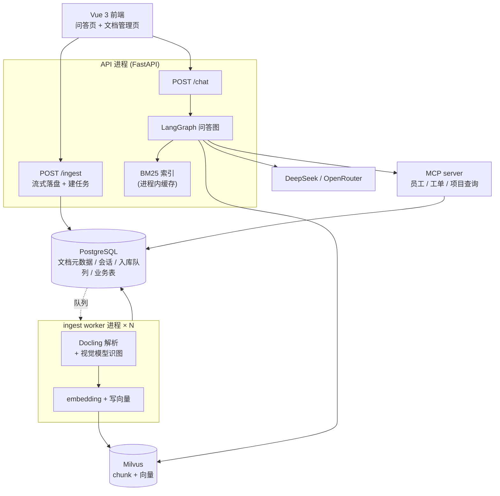
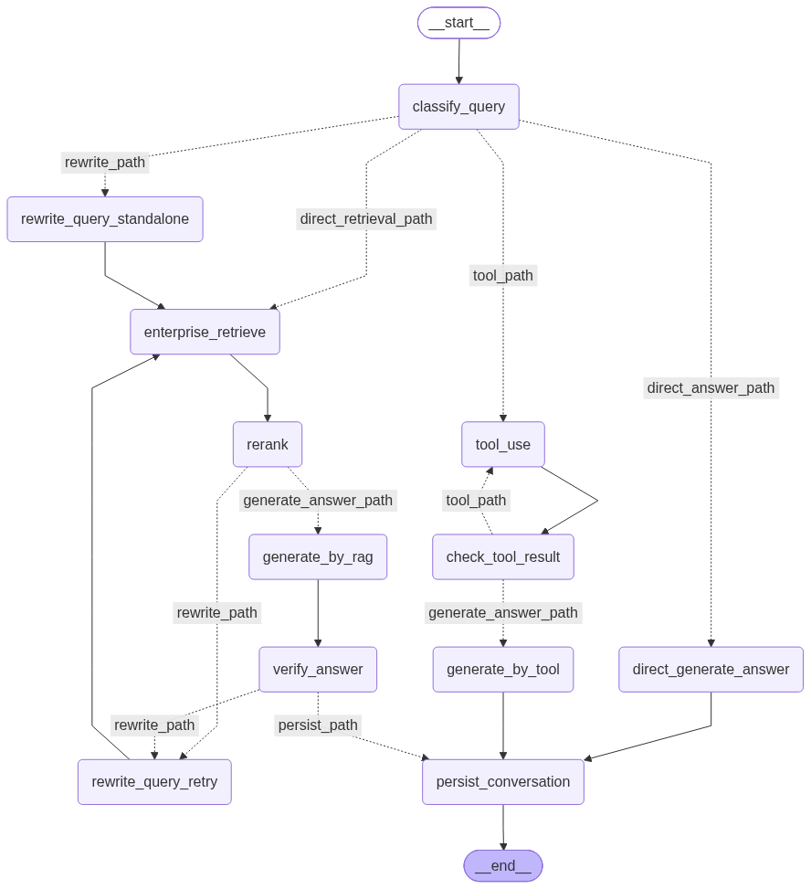

# Enterprise Knowledge Base QA System

一个面向企业内部文档的知识库问答系统：上传企业文档（PDF / Word / PPT / 图片），系统异步解析、切块、向量化入库；提问时由 LangGraph 判断该走**知识库检索**、**业务系统工具调用**还是**直接回答**，并把结果落成可追溯的会话。

## 这个项目解决了什么

企业内部问答案例里，难点通常不在"能不能调通大模型"，而在下面这些地方——它们也是这个仓库着力最多的部分：

- **入库不能卡住请求**。Docling 解析一份大文档要几十秒到几分钟，所以 `POST /ingest` 只登记任务就立刻返回 202，真正的解析由独立 worker 进程消费，靠数据库租约（`FOR UPDATE SKIP LOCKED` + 心跳续租）保证多进程不重领、进程崩了能被自动捡回。
- **光靠向量检索查不准**。企业文档里大量是编号、代码、专有名词，纯语义检索经常漏，所以用**向量 + BM25 双路召回再做 RRF 融合**，融合结果再用 rerank 模型逐篇打分，带主阈值 + 兜底阈值两级筛选。
- **不是所有问题都该查文档**。"我的工单处理到哪了"这类问题查知识库只会得到幻觉，所以先做查询分类，该走工具链路的走 MCP 工具查业务库。
- **大模型和工具都会不按套路出牌**。结构化输出会被 token 上限截断、参数会填错、MCP 会话会断、HTTP 会 429——这些失败各自有独立的处理策略（重试 / 回灌修复 / 上报"结果不确定"），而不是一句 `except: pass`。

## 架构



下面是问答图的完整流程图。它**不是手画的**，而是 LangGraph 从 `graph/main.py` 编译出的图直接渲染的（`test.ipynb` 里画的就是同一张图）：



改动 `graph/main.py` 的节点或边之后，这张图**不会自动更新**，要重新渲染覆盖，否则它会和图结构脱节：

```bash
python -c "from graph.main import get_app; get_app().get_graph().draw_mermaid_png(output_file_path='docs/images/qa-graph.png')"
```

渲染走 mermaid.ink 在线服务（`draw_mermaid_png` 的默认 `draw_method` 就是它），需要能访问外网。想拿可 diff 的文本版做前后对比，用 `print(get_app().get_graph().draw_mermaid())`；`test.ipynb` 里也是这段代码。

各节点的职责（`graph/node.py`）：

| 节点 | 作用 |
| --- | --- |
| `classify_query` | 判断这次提问是否需要检索 / 是否需要先改写 / 是否需要调工具 |
| `rewrite_query_standalone` | 检索前的改写：把追问补全成能独立检索的查询。它不是失败重试，不占 `rewrite_times` 预算 |
| `enterprise_retrieve` | 混合检索：向量 + BM25 双路召回，RRF 融合 |
| `rerank` | 逐篇打分，主阈值筛选；一篇都不过时降级到兜底阈值重筛 |
| `rewrite_query_retry` | 失败后的重写：相关性不达标或答案验证不通过时触发，**计入** `rewrite_times` |
| `generate_by_rag` | 基于检索到的片段生成回答 |
| `verify_answer` | 校验答案是否有上下文支撑，不通过就回到重写 |
| `direct_generate_answer` | 不检索也不调工具，直接回答 |
| `tool_use` | 调 MCP 工具（决策 → 执行 → 失败则把工具 schema 回灌给模型重新决策） |
| `check_tool_result` | 判断工具结果够不够，不够就再调一轮 |
| `generate_by_tool` | 基于工具结果生成回答 |
| `persist_conversation` | 把这一轮问答写进 `messages` 表 |

路由分支由 `graph/routes.py` 决定。注意 `classify_query` 出来的是**四条互斥的路径**，其中 `direct_retrieval_path`（直接检索）和 `rewrite_path`（先改写再检索）是并列的两条——不是所有检索都要先改写，这取决于分类结果里的 `need_rewrite`。

## 技术栈

| 层 | 选型 |
| --- | --- |
| 后端 | FastAPI + Uvicorn，SQLAlchemy async |
| 问答编排 | LangGraph（状态图 + 条件路由） |
| 大模型 | DeepSeek（对话 / 视觉）、OpenRouter（备用） |
| 文档解析 | Docling，图片交给视觉模型 |
| 检索 | Milvus（向量）+ rank-bm25（全文）+ RRF 融合 + FlagEmbedding rerank |
| 工具调用 | FastMCP（独立进程，HTTP 传输） |
| 前端 | Vue 3 + Element Plus + Pinia + Vite |
| 日志 | loguru |
| 评估 | ragas |

## 快速开始

### 1. 前置

- Python 3.12
- PostgreSQL（需要业务表：`departments` / `employees` / `projects` / `tickets`，以及文档与会话表）
- Milvus（standalone 即可）
- 一个 DeepSeek API key（对话 + 视觉 + embedding 都走它）

仓库里没有建表脚本，默认这些表和 collection 已经存在。

### 2. 安装

```bash
pip install -r requirements.txt
```

需要 GPU 时改用 PyTorch 官方源装对应 CUDA 版本：

```bash
pip install torch==2.14.0 --index-url https://download.pytorch.org/whl/cu126
```

### 3. 配置

```bash
cp .env.example .env
```

`.env.example` 里每个变量都有注释说明是否必需。最少要填 `DEEPSEEK_API_KEY`、`POSTGRESQL_URL`、`MILVUS_URI`、`EMBEDDING_MODEL`。

### 4. 启动

```bash
python -m uvicorn app.main:app --host 127.0.0.1 --port 8000
```

启动 API 时会**自动拉起** ingest worker 监督器和 MCP server（由 `AUTO_START_WORKERS` / `AUTO_START_MCP` 控制，默认开启），并用后台任务预热 rerank 模型和 BM25 索引，所以正常情况下一条命令就够了。

如果你想手动分别启动（例如用 `--reload` 开发时，热重载会反复拉起每个常驻 1.5–3GB 的 worker）：

```bash
python run_workers.py 3       # 起 3 个 ingest worker，进程管理器会自动重启挂掉的
```

```bash
python -m MCP.server          # 必须用 -m 模块方式，脚本方式会因 from db 解析失败
```

### 5. 前端

```bash
cd frontend && npm install && npm run dev
```

默认 `http://localhost:5173`（与后端 CORS 白名单一致）。后端地址在 `frontend/src/api/client.js` 配置。

访问 `http://127.0.0.1:8000/docs` 可以看到后端接口文档。

## Docker 部署

后端整套（API + ingest worker + MCP server）打成一个镜像。这三者是同一棵进程树——
`app/main.py` 的 lifespan 会把 worker 监督器和 MCP server 一并拉起来，所以容器里
只需要跑 uvicorn。前端不在这个镜像里——它是编排里另一个独立服务（见下面第 5 步），
自己一个几十 MB 的镜像，改前端不会碰到后端那几个 GB 的依赖层。

### 1. 前置

宿主机上要已经有 PostgreSQL 和 Milvus 在跑。容器通过 `host.docker.internal` 连它们
（容器里的 `127.0.0.1` 指的是容器自己，连不到宿主机的服务）。

### 2. 配置

编辑仓库根目录的 `.env.docker`。必填 `DEEPSEEK_API_KEY`、`OPENROUTER_API_KEY` 和
`POSTGRESQL_URL`。

这个文件放的是**容器视角**的值，别拿根目录那份 `.env` 直接顶替：那里的 `127.0.0.1`
和 `RERANKER_MODEL_PATH=D:\AIModels\...` 在 Linux 容器里都不成立。文件顶部注释说明了
两件容易踩的事——为什么不能留 `VAR=` 这种空值行，以及为什么 `RERANKER_MODEL_PATH`
干脆不写（不写才能落到默认值，用构建时已经下好的权重）。

### 3. 建 schema

全新的库要先建表和 collection：

```bash
docker compose run --rm app python -m db.init_db
```

幂等：已存在的表和 collection 整块跳过，重复跑不会出错也不会改动已有结构。

### 4. 起服务

```bash
docker compose up -d
```

### 5. 前端

前端也在这个编排里，是独立的 `frontend` 服务：那个 nginx 既发 `vite build` 出来的静态
文件，又把 `/api` 反代给 app 容器（配置在 `frontend/nginx.conf`）。

**对外只有一个入口，打开 `http://localhost:5173`**（`127.0.0.1:5173` 也一样——前后端
同源，不涉及 CORS）。前端的请求走相对路径 `/api`，由这个 nginx 转发，所以 app 容器
**不需要发布 8000 端口**。接口文档在 `http://localhost:5173/api/docs`。

`frontend/nginx.conf` 里有两个默认值必须显式调大，否则会在交付之后才发现：
`client_max_body_size`（默认只有 1MB，不改的话传文档直接 413）和 `proxy_read_timeout`
（默认 60s，而 `/chat` 要跑完整的 RAG + LLM，前端 axios 等的是 180s）。

⚠️ 宿主机上的 `npm run dev` 现在连不到后端（8000 没发布），**已经不可用**；前端开发走容器。

### 关于这个镜像

**模型权重在构建期就下好了**，运行时不再联网——Docling 的版面/表格模型、以及
rerank 用的 `BAAI/bge-reranker-v2-m3`。代价是构建要下载几个 GB、耗时较长；换来的是
容器可以离线冷启动。（OCR 那几个权重是 `rapidocr` 包自带的，pip 装上就有，不用额外下。）

**torch 是 CUDA 版**（cu126，和开发机装的是同一个）。注意 PyPI 上并没有 CPU 版 torch——
`pip install torch==2.14.0` 拿到的是 CUDA 13 构建，CPU 版在 `download.pytorch.org/whl/cpu`
那个专用源上。基础镜像不用换成 `nvidia/cuda`，CUDA 运行时会以 `nvidia-*` 这些 pip 包进来。

宿主机侧只要 Docker Desktop 的 GPU 透传可用就行。WSL2 下透传给容器的是 `/dev/dxg`，
**别拿 `/dev/nvidia*` 判断有没有成功**——WSL2 不用那套设备节点，`ls /dev/nvidia*` 永远是空的。
要出纯 CPU 镜像：加 `--build-arg TORCH_INDEX=https://download.pytorch.org/whl/cpu`，
同时删掉 `docker-compose.yml` 里的 GPU 预留。

**资源。** 瓶颈是**内存**，不是显存。每个 ingest worker 常驻 1.5–3GB，所以 `.env.docker`
里 `INGEST_WORKERS` 用的是 1 而不是默认的 2，compose 里容器上限设的 6g。

这个上限必须压在 WSL2 虚拟机总内存之下，而 WSL2 默认只给物理内存的一半（这台机器
15.7GB → 7.6GB）。想在 Windows + Docker Desktop 上调大，得改仓库外的
`C:\Users\<你>\.wslconfig`——Docker Desktop 用 WSL2 后端时没有内存滑块，那是唯一的开关，
而且要 `wsl --shutdown` 才生效。注意两个副作用：它会同时作用于所有 WSL2 发行版；WSL2
也不会主动把不用的内存还给 Windows，调大后宿主机可用内存会明显变少。

显存实测：reranker 1.1GB，每个 worker 的 Docling 约 0.4–0.7GB（用一份纯文字小 PDF 测得，
带表格/图片的文档会触发更多模型）。8GB 的卡不构成瓶颈。

## 设计要点

几个值得单独说明的实现决定，完整版在 [`docs/agent.md`](docs/agent.md)：

**入库是生产者/消费者结构。** 请求侧和 worker 侧不直接通信，只通过 `ingest_job_items` 表交接。领活用一条 SQL 同时完成"挑待处理的 / 挑租约过期的僵尸 / 原子置为 running 并挂租约"，不需要额外的调度器或 reaper。并发度只来自进程数，分发由数据库的 `FOR UPDATE SKIP LOCKED` 完成。文件内容哈希决定 `doc_id`，所以同一份文件重复上传或重试会落到同一批主键上，Milvus 的 upsert 才是真的覆盖而不是灌重复数据。

**BM25 索引靠语料指纹失效。** 索引建在 API 进程内存里，而入库发生在 worker 进程，两边没有通知通道。所以每次检索前读一次 `documents` 表的 `(行数, 最大上传时间)` 作为指纹，和自己建索引时记下的比对，不一致就重建。指纹必须在开始扫描 Milvus **之前**读取，否则扫描期间新写入的文档会被记进指纹却不在索引里，那份索引就永远漏掉它。

**工具链路带失败回灌。** 参数填错、服务端瞬时故障、结果不确定、不可重试——四类失败分别处理。值得重试的失败会把**该工具的正确参数定义（input_schema）原样回灌给模型**重新决策，实测比只丢一句"参数错了"有效得多；非幂等的写操作（`create_ticket`）在"请求可能已送达"时不会重发，而是如实上报不确定性。

**大模型调用有独立的容错层。** 异常按类型分类成可重试 / 不可重试，指数退避带抖动；输出被 token 上限截断时扩容重试，结构化输出不合规时把校验错误回灌成下一轮输入。异常分类是纯函数、不打日志，日志只记在真正的边界上——这样同一个异常不会在三个层次各打一遍，也不会把"会被成功修复的错误"记成 ERROR。

**日志带关联标识。** 并发跑多个 worker、多个会话时，靠日志本身分不清哪几行属于同一次请求。现在入口处用 `logger.contextualize` 绑一次（`/chat` 绑 `thread_id`，worker 绑 `worker_id`+`item_id`，`/ingest` 绑 `job_id`），靠 contextvars 自动穿透 LangGraph 节点、检索层和 MCP 工具链路，行尾统一渲染成 `| thread_id=...`。级别由 `LOG_LEVEL` 控制，调试时设成 `DEBUG` 能看到检索耗时和逐篇 rerank 打分。

## 目录结构

```text
app/          FastAPI 入口、API router、schema、日志配置、ingest worker
core/         配置、LLM 调用与容错、reranker、embedding、提示词
db/           SQLAlchemy 模型、PostgreSQL/Milvus 仓储层、入库任务状态机
ingestion/    文档解析、图片理解、切块
retrieval/    向量检索、BM25、RRF 混合检索
graph/        LangGraph 状态、节点、路由、编译入口
MCP/          MCP 工具服务端（独立进程）与工具路由客户端
frontend/     Vue 3 前端
eval/         离线评估脚本与各轮评估结果
docs/         项目文档
run_workers.py  ingest worker 的进程管理器
```

## 评估

`eval/` 下有多轮离线评估（`1st_eval` … `6th_eval`），用 ragas 的 Context Precision / Recall / Faithfulness / Answer Relevancy 四项指标，记录了 rerank 替换、chunk 策略调整等改动前后的对比。

各轮目录里的 `rag_result.jsonl` / `eval_result.jsonl` 保存了评估时**检索到的文档片段原文和参考答案**，体积不小；它们是为了让指标可复核才保留的，不是示例数据。

## 已知限制

- **没有测试套件**。改动后最基础的验证是 `python -m compileall`，以及针对被改模块做导入/单点调用。
- **`db/models.py` 没有迁移**，表结构靠外部已存在的库与之对齐。
- **每个 ingest worker 进程常驻一份 Docling 模型**（约 1.5–3GB），并行度的真实上限是内存而不是 CPU。
- **BM25 索引每次语料变化都要整体重建**，重建落在下一个检索请求的路径上（启动时已预热一次，但入库之后那次重建仍会让该请求变慢）。
- **`verify_answer` 只把模型输出精确等于 `YES` 视为通过**，这是脆弱契约：换模型后如果返回 `Yes.` 之类，会把答案推去重写白跑一轮。
