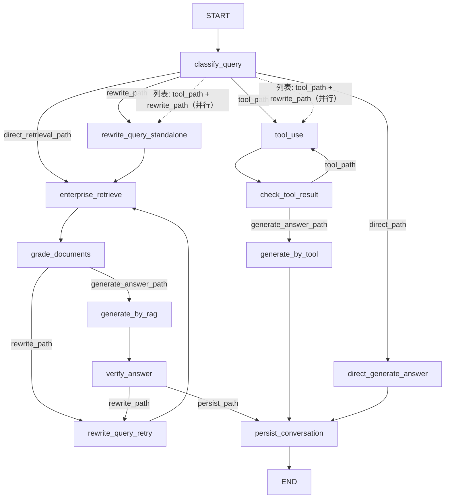

# agent.md

> 本文档面向后续在 `Enterprise Knowledge Base QA System` 仓库上工作的 AI agent 和开发者，描述当前项目真实的代码结构、数据流、运行方式、常见约定和已知缺口。
>
> 最后同步日期：2026-09-26

## 1. 项目是什么

这是一个基于 RAG 的企业文档知识库问答系统：

- 用户上传企业文档（docx、pdf、pptx、图片等）；
- 系统用 Docling 解析文档，用视觉模型理解文档图片，然后切块并向量化；
- 文本块写入 Milvus，文件、会话和消息元数据写入 PostgreSQL；
- 用户提问后，系统通过 LangGraph 判断是否需要企业知识库检索、是否需要调用业务工具；
- 需要检索时执行“向量检索 + BM25 + RRF 融合”的混合检索，对结果做相关性筛选后生成回答；
- 需要业务数据（员工 / 工单 / 项目）时，通过 MCP 工具调用查 PostgreSQL，再依据工具结果生成回答；
- 文档入库是异步的：`POST /ingest` 只登记任务并立即返回，真正的解析和写向量由独立的 worker 进程完成。

## 2. 技术栈与依赖

项目没有 `pyproject.toml`，`requirements.txt` 已按源码里的实际 import 逐个核对并固定版本。有几处「import 名 ≠ 包名」（`jieba` 由 `jieba3k` 提供、`docling` 由 `docling-slim` 提供、`fastmcp` 由 `fastmcp-slim` 提供），文件顶部有说明。注意 `asyncpg` 不在任何 `import` 里，它由 SQLAlchemy 按 URL 的驱动名动态加载，漏了会在建 engine 时才炸。实际依赖包括：

- `fastapi`、`uvicorn`
- `pydantic`、`pydantic-settings`
- `sqlalchemy[asyncio]`（使用 async engine/session）
- `pymilvus`
- `langchain`、`langchain-core`、`langchain-openai`、`langchain-text-splitters`、`langgraph`
- `fastmcp`、`mcp`（MCP 工具服务端与客户端）
- `docling`、`docling-core`
- `openai`（经由 langchain-openai 间接使用）
- `jieba`、`rank-bm25`
- `ragas`、`datasets`（仅评估脚本使用）
- `aiofiles`、`loguru`、`python-dotenv`
- Python 3.12+（`graph/node.py` 使用了 PEP 701 风格的嵌套引号 f-string，仓库现有 `__pycache__` 也是 3.12 / 3.14 编译产物）

外部服务：

- PostgreSQL：文档元数据、thread、message、ingest 任务队列，以及业务表（员工 / 工单 / 项目）；
- Milvus：chunk 文本和向量，同时作为 BM25 全量语料来源；
- DeepSeek/OpenRouter：LLM、视觉模型与 embedding 后端；
- 本仓库自带的 MCP 工具服务：`MCP/server.py`，HTTP 传输，默认监听 `127.0.0.1:8001`；
- Tavily：配置中存在 `TAVILY_API_KEY`，但当前问答图尚未接入 Web 搜索工具。

## 3. 顶层目录职责

```text
app/                 FastAPI 应用入口、API router、schema、日志配置，以及 ingest worker
core/                配置、LLM、vision model、embedding 等基础能力
db/                  SQLAlchemy 模型、PostgreSQL/Milvus 仓储层、ingest 任务状态机
ingestion/           文档解析、图片理解、切块、向量入库
retrieval/           向量检索、BM25、混合检索
graph/               LangGraph 状态、节点、路由、编译入口
MCP/                 MCP 工具服务端（server.py）与工具路由客户端（client.py）
uploads/             上传文件落盘根目录，按 job_id 分子目录；worker 用完即删
frontend/            Vue 3 + Element Plus + Pinia 前端（聊天 + 文档管理两个页面）
eval/                RAG / 检索评估脚本与历史评估结果
app/main.py          真正的 FastAPI 入口
run_workers.py       ingest worker 的进程管理器（反复拉起 `python -m app.worker`）
README.md            面向使用者的快速开始与架构说明（本文件是面向 agent 的深入版）
requirements.txt     运行时依赖，已固定版本；顶部说明了几处「import 名 ≠ 包名」
.env.example         .env 的变量模板（只有变量名和注释，没有真实值）
docs/                本文件、容错设计稿、历史 pip freeze 记录
```

模块内没有 `src/` 或 `notebook/` 等正式目录，也没有遗留的 `.ipynb` 原型文件。以下约定需要保持：

- `db/` 目录名是小写包名（此前为全大写 `DB`，已统一为小写）；
- `retrieval/` 是检索模块目录，函数名用 `hybrid_retrieval`/`vector_retrieval`，与目录拼写一致；
- `MCP/` 目录名保留大写——本地包若改成小写 `mcp` 会遮蔽第三方 `mcp` SDK（`fastmcp` 的依赖），工具链路会报 `No module named 'mcp.shared'`；
- `MCP/` 是**一个独立的服务进程**，不是纯库——只改 `MCP/client.py` 而不重启 `MCP/server.py`，工具 schema 的变更不会生效。

## 4. 数据模型与存储边界

### PostgreSQL（SQLAlchemy async）

基础会话：

- `db/models.py::Thread`：`id`、`title`、`created_at`、`updated_at`；
- `db/models.py::Document`：`doc_id`、`filename`、`file_path`、`file_type`、`upload_time`；
- `db/models.py::Message`：`id`、`thread_id`、`role`、`content`、`sources`、`verification`、`created_at`；
  - `sources` 是 JSON，Python 默认值为 `None`，但注解写成 `Mapped[list]` 而不是 Optional；
  - `verification` 是 Boolean，Python 默认值为 `None`，但注解写成 `Mapped[bool]` 而不是 Optional；
  - `role` 的字段注释写的是 `# "user" | "assistant"`，但 `persist_conversation` 实际写入的是 `"Human"` 和 `"AI"`。**注释是错的，以代码为准**——按注释里的值去过滤 `role` 会一行都查不到。

入库任务队列：

- `db/models.py::IngestJob`：`id`、`status`、`total`、`created_at`、`finished_at`；
- `db/models.py::IngestJobItem`：`id`、`job_id`、`filename`、`stored_path`、`content_hash`、`status`、`attempts`、`worker_id`、`lease_expires_at`、`doc_id`、`chunk_count`、`error`、`updated_at`。

业务数据表（供 MCP 工具查询，与 RAG 文档库互不相通）：

- `Department`、`Employee`、`Project`、`Ticket`；
- `Ticket.status` 取值 `open` / `in_progress` / `resolved` / `closed`，`Ticket.priority` 取值 `P1` / `P2` / `P3`；
- 这四张表是 MCP 工具唯一的查询对象，**知识库文档里没有这些表的业务数据**——判断一条提问该走检索还是走工具时，这一点很关键（见第 11 节第 18 条）。

`db/models.py::DocumentChunk` 是 Pydantic 模型，不代表 SQL 表；它描述 Milvus 返回的 chunk 结构。

`Mapped[list]`/`Mapped[bool]` 与 `default=None` 的组合会让模型推断出的列可空性与运行时写入产生歧义；若数据库严格按模型 DDL 建表，持久化 user 消息时的 `sources=None`、`verification=None` 可能违反非空约束。

**注意 `db/models.py` 里 `_uuid` 被定义了两次**（第 10 行返回 `str`，第 81 行返回 `uuid.UUID`）。前者被 `Thread`/`Document`/`Message` 捕获，后者被 `Department`/`Employee`/`Project`/`Ticket` 使用。当前行为正确（两组表的列类型本来就不同），但两个同名函数语义相反，改动时极易踩错——不要合并它们，如果一定要动，请显式改名。

### Milvus

- collection、database、URI 均由 `.env` 配置；
- chunk 数据结构约等于：`id/content/metadata/vector/created_at`；
- `metadata` 当前写入 `source`、`chunk_index`、`doc_id`；
- 向量检索使用 `query_doc`，BM25 会通过 query iterator 拉取全量 `content` 并在内存中构建索引。

仓库没有发现迁移脚本或显式建表/建 collection 逻辑，默认外部 PostgreSQL 表与 Milvus collection 已存在。

## 5. 文档入库链路

这是一个生产者/消费者结构，请求侧和 worker 侧**不直接通信**，只通过 `ingest_job_items` 表交接：

```text
POST /ingest (multipart files)                         ← 生产者，跑在 API 进程
  -> app/api/routes_ingest.py::save_to_uploads
       -> 流式落盘到 uploads/<job_id>/<uuid4().hex><ext>
       -> 边写边算 sha256，得到 content_hash
  -> 一个事务里写入 ingest_jobs 一行 + 每条文件一行 ingest_job_items(status='pending')
  -> 返回 202 {job_id, total}，立刻返回，不等解析

app/worker.py                                          ← 消费者，独立进程
  -> claim_items()：FOR UPDATE SKIP LOCKED 领一条，置 running 并挂租约
  -> _heartbeat()：每 INGEST_HEARTBEAT_SECONDS 续租一次
  -> ingestion/ingest_doc.py::ingest_doc
       -> ingestion/process.py::process_doc
            -> 图片文件：视觉模型直接识图
            -> 其他文件：Docling 解析（走 asyncio.to_thread）
                 -> PictureItem 保存为 picture_{index}.png 后并发调用视觉模型
                 -> TableItem 转 Markdown
            -> RecursiveCharacterTextSplitter 切块
       -> db/vector_repository.py::store_documents_bulk -> embedding -> Milvus upsert
  -> add_document_if_absent(Document(...))             ← 向量写成功后才落 documents 行
  -> mark_done() / release_for_retry() / mark_failed()
  -> 成功后删除 uploads 里的源文件和空目录

GET /ingest_jobs/{job_id}                              ← 前端轮询进度
```

关键实现细节：

- 文档内容哈希决定 `doc_id`（`uuid5(NAMESPACE_URL, content_hash)`），所以同一份文件重复上传或重试会落到同一个 `doc_id`，`documents` 行的去重和 Milvus 主键的覆盖都靠这个成立；
- 存储路径用 `uuid4().hex` 生成，与原始文件名无关，因此**同名文件不会互相覆盖，也不存在路径穿越**；扩展名经 `_safe_ext` 白名单过滤并统一小写；
- `process_doc` 默认 `chunk_size=500, chunk_overlap=100`，`ingest_doc` 也以该参数调用；
- 图片在文档解析过程中保存为 `picture_{index}.png`，识别任务并发执行，完成后统一删除；
- 图片 prompt 是“这张图里有什么？”，返回文本会夹在 `<-- image -->` 标记之间；
- 先写 Milvus 再写 `documents` 行，避免出现“列表里有、检索不到”的孤立记录；
- worker 里 `os.environ` 的 `OMP/MKL/OPENBLAS_NUM_THREADS` 必须在 import torch/docling **之前**设置，否则多进程会互相抢 CPU，总吞吐反而低于串行；
- 一个进程一次只处理一篇文档：Docling 是 CPU + GIL 密集的，同进程内开协程压不出并行，只会让心跳饿死；
- 并发度只来自**进程数**，用 `run_workers.py N` 起多个；分发由数据库的 `FOR UPDATE SKIP LOCKED` 完成，不需要调度器，也没有独立的 reaper 进程。

### ingest_job_items 状态机

```text
    pending ──领活──▶ running ──成功──▶ done
       ▲                 │
       │                 ├──失败且还有额度──▶ pending
       └──(重试额度用尽)──┴──失败且额度用尽──▶ failed
```

- 领活用一条 SQL 同时完成“挑待处理的 / 挑租约过期的僵尸 / 原子置为 running 并挂租约”，僵尸回收折在 `WHERE` 条件里；
- `attempts` 在每次领活时自增，`INGEST_MAX_ATTEMPTS` 次之后判死；
- `job` 的整体状态是对 item 现算聚合出来的，不维护计数器（多进程下计数器必然算错）；`ingest_jobs.status` 只是给任务列表省一次 join 的缓存；
- 重算 job 状态前必须先取 job 行的排他锁，否则两个 worker 可能各自基于过期快照互相覆盖，把终态又写回 running。

## 6. 问答链路

LangGraph 定义在 `graph/`：

- `graph/state.py`：`State` 是 TypedDict；
- `graph/node.py`：每个节点函数；
- `graph/routes.py`：条件路由；
- `graph/main.py`：全局 `builder`，`get_app()` 编译并返回 graph。

`State` 里同时存在 `need_tool`（当前使用）和 `need_tools`（历史遗留，无人读写）。两者只差一个字母，改字段时务必确认改的是哪一个。

当前图结构：



节点职责：

- `classify_query`：结合最多 6 条历史消息判断 `need_retrieval`、`need_tool`、`need_rewrite` 三个布尔量，派生 `query_type`，并初始化 `rewrite_times` 与 `original_question`；结构化输出解析失败时按 `need_retrieval=True, need_rewrite=False, need_tool=False` 兜底；
- `direct_generate_answer`：不检索，只用通用知识回答，只返回 `final_answer`；
- `rewrite_query_standalone`：`need_rewrite=True` 时在检索前把追问补全成可独立检索的查询，只更新 `question`，不占用 `rewrite_times` 预算；
- `enterprise_retrieve`：以当前 `question` 调 `hybrid_retrieval(question, 50, 50, 30)`，返回 `retrieval_docs`（最多 30 篇候选）；
- `grade_documents`：并发让 LLM 逐篇判断检索结果是否相关（单篇判断失败按不相关处理，不中断整次问答）；无相关结果时返回“没有找到相关文档”并显式清空 `sources`/`rag_context`/`verification`；有结果时生成 `rag_context` 和去重后的 `sources`；
- `generate_by_rag`：把历史、问题、相关片段拼进 prompt 生成回答；
- `verify_answer`：让 LLM 返回 `YES`/`NO`，将结果转换成 Python `bool` 存入 `verification`；
- `rewrite_query_retry`：相关性不达标或验证不通过时改写问题，每次计入 `rewrite_times`，最多重写 2 次后重新检索；
- `tool_use`：把当前问题和上一轮工具结果拼起来交给工具路由，通过 MCP 并发调用工具，把结果文本写入 `tool_result`，`tool_use_times` 自增；
- `check_tool_result`：用结构化输出判断工具结果是否足以回答问题，写入 `need_more_tools`；
- `generate_by_tool`：依据 `tool_result` 生成回答；
- `persist_conversation`：向 PostgreSQL 写入一条 Human 消息和一条 AI 消息，并保存 AI 消息的 `sources`/`verification`。

两个改写节点共用 `_rewrite_question` 和同一段 `REWRITE_PROMPT`，但预算语义不同：`rewrite_query_standalone` 是检索前补全追问，不计入 `rewrite_times`；`rewrite_query_retry` 是失败重试，计入预算。因此 `MAX_REWRITE_TIMES=2` 是纯重试额度，追问不会因为前置改写而少一次重试机会。工具链路的预算由 `MAX_TOOL_USE_TIMES=5` 单独控制。

混合检索在 `retrieval/hybrid_retrieval.py`：

1. 取 BM25 索引（`await get_bm25()`）并与 Milvus 向量检索并行执行；
2. 使用 reciprocal rank fusion 融合（按名次融合，两路权重相同，不使用原始相似度）；
3. 返回结构为 `[{id, content, metadata, score}]`，`score` 是 RRF 位次分，不是相似度。

### BM25 索引的生命周期

BM25 索引是**进程内**的，而入库跑在 worker 进程里，两边没有通知通道，所以不做推送，改成"每次检索前读一次语料指纹"：

```text
db/document_repository.get_corpus_version()
   -> f"{documents 行数}:{max(upload_time)}"

retrieval/bm25_retrieval.get_bm25()
   -> 指纹与建索引时记下的一致   -> 直接返回内存里的旧索引（约 2~3ms 一次查询）
   -> 不一致                     -> asyncio.to_thread 全量重扫 Milvus 重建，记下新指纹
```

要点：

- 指纹用 `(行数, 最新 upload_time)` 而不是单独的计数器，同时覆盖"删文档"（行数变小）和"删一篇又加一篇"（行数抵消但 `upload_time` 变大）；
- `documents` 行是 worker 在**向量写成功之后**才写的，所以指纹一变，Milvus 里确实多了东西；
- 重复上传同一份文件（内容哈希相同、`doc_id` 相同）不写新行、指纹不变——正好对应"语料没变"，不会触发无谓的重建；
- 指纹必须在**扫描 Milvus 之前**读取。反过来（先扫描后读指纹）会把扫描期间新写入的文档记进指纹、却不在索引里，那份索引就永久漏掉它；
- 重建走 `asyncio.to_thread`，不会卡住事件循环；并发请求同时发现失效时由模块级 `asyncio.Lock` 保证只重建一次，其余等锁复用（已实测：5 个并发失效请求只触发 1 次重建）。

**worker 侧没有任何改动**：它照常写 `documents` 行，刷新是靠 API 侧比对指纹"拉"出来的。代价是刷新发生在任务完成**之后的下一次检索**，而不是任务完成的那一刻——因为索引只在被查询时才有意义，这个差异观察不到。

多进程部署时，每个 API 进程各持一份索引、各自按指纹独立重建，不需要相互协调。

### 工具链路（MCP）

```text
MCP/server.py                     ← 独立进程，HTTP 传输，127.0.0.1:8001
  工具：get_weather / search_employees / search_tickets / search_project / create_ticket
  查询类工具均支持 limit / offset（默认 10，上限 100），走 SQLAlchemy 异步会话直查 PostgreSQL

MCP/client.py                     ← 被 graph/node.py::tool_use 调用
  MCPClient.get_catalog_text()        首次 list_tools 后缓存工具目录
  MCPClient.make_toolcall_decision()  用结构化输出决定调用哪些工具及参数
  MCPClient.tool_call()               asyncio.gather 并发执行
  get_mcp_client()                    lru_cache 单例
```

### LLM 调用容错（core/llm.py）

`core/llm.py` 提供三个显式模型工厂（`get_deepseek_chat_llm` / `get_deepseek_vision_llm` / `get_openai_chat_llm`，chat 类均带 `timeout=60`），并在此之上封装了一层统一的调用容错，`graph/node.py` 的所有 LLM 节点都经 `llm_invoke_gateway` 调用：

- `classify(exc)`：把异常归为 `RetryableError` / `NonRetryableError` / `UnknownError`。网络类（`APIConnectionError`/`APITimeoutError`）、限流（`RateLimitError`）、服务端 500（`InternalServerError`）判为可重试；认证 / 参数 / 校验错误判为不可重试。
- `invoke_llm`：单次调用 + 响应后检查。`BaseMessage` 分支查 `finish_reason == "length"`（→ `TokenLimitError`）和空内容（→ `EmptyContentError`）；`dict` 分支（`with_structured_output(include_raw=True)`）查 `parsing_error`（→ `OutputSchemaError`）。
- `invoke_with_backoff`：对 `RetryableError` 做指数退避 + 抖动（`LLM_RETRY_BASE_DELAY` / `LLM_RETRY_MAX_DELAY`），最多 `max_attempts` 次。
- `llm_invoke_gateway`：外层修复循环。纯文本触发 `TokenLimitError` 时逐步 `bind(max_tokens=...)` 扩容；结构化输出触发 `OutputSchemaError` 时把错误回灌成一条 `HumanMessage` 让模型重来。

`graph/node.py` 里三个结构化输出调用点（`classify_query` / `grade_one` / `check_tool_result`）都已改用 `format_messages()` 构造消息列表，以支持回灌时 `messages.append(...)`。

## 7. API 现状

实际入口为 `app/main.py`。它会挂载 `ingest`、`chat`、`document`、`thread` 四组 router，并提供自定义 Swagger UI。

当前接口：

| Method | Path | 文件 | 状态 |
|---|---|---|---|
| POST | `/ingest` | `routes_ingest.py` | 已挂载，**202 异步**，返回 `{job_id, total}` |
| GET | `/ingest_jobs/{job_id}` | `routes_ingest.py` | 已挂载，轮询入库进度 |
| POST | `/chat` | `routes_chat.py` | 已挂载 |
| DELETE | `/delete_document?id=` | `routes_document.py` | 已挂载 |
| GET | `/get_documents` | `routes_document.py` | 已挂载 |
| GET | `/get_threads` | `routes_thread.py` | 已挂载 |
| GET | `/get_thread_messages?id=` | `routes_thread.py` | 已挂载 |
| DELETE | `/delete_thread?id=` | `routes_thread.py` | 已挂载 |
| GET | `/docs` | `app/main.py` | 自定义 Swagger UI |
| GET | `/openapi-swagger.json` | `app/main.py` | 自定义 OpenAPI 3.0 |

`/chat` 当前行为：

- `thread_id` 有值时读取该会话历史；为 `None` 时创建新 thread；
- graph 输入使用 `question`、`thread_id`、`chat_history`；
- 返回值从 graph 结果读取 `question`、`final_answer`、`rag_context`、`verification`、`sources`；
- `ChatResponse.tool_used` 字段已声明但路由从不填充，恒为 `None`；
- graph 抛异常时统一转成 500，并把 `str(exc)` 放进 `detail` 返回给客户端。

## 8. 配置与环境变量

根目录有 `.env`（**已被 `.gitignore` 排除，且已从 git 索引移除**），`core/config.py` 使用 `load_dotenv(override=True)` 加载。会读取的变量：

```text
DEEPSEEK_API_KEY
DEEPSEEK_BASE_URL
OPENROUTER_API_KEY
OPENROUTER_BASE_URL
POSTGRESQL_URL
MILVUS_URI
MILVUS_DB
MILVUS_COLLECTION
EMBEDDING_MODEL（core/embedding.py 直读它，走 OpenRouter 的 embedding 端点）
EMBEDDING_DIM（.env 里有，但代码不读）
TAVILY_API_KEY（.env 里有，但问答图尚未接入 Web 搜索）
RERANKER_MODEL_PATH（本地权重目录或 HF 模型 id；代码默认值是可移植的 `BAAI/bge-reranker-v2-m3`，本机路径写在 .env 里覆盖）
VISION_CONCURRENCY（默认 6）
INGEST_LEASE_MINUTES（默认 10）
INGEST_HEARTBEAT_SECONDS（默认 120）
INGEST_MAX_ATTEMPTS（默认 3）
INGEST_POLL_SECONDS（默认 5）
INGEST_WORKERS（默认 2）
AUTO_START_WORKERS / AUTO_START_MCP（默认 "1"，见第 9 节）
LOG_LEVEL（app/logging_config.py 读，默认 INFO）
LLM_RETRY_BASE_DELAY（默认 1）
LLM_RETRY_MAX_DELAY（默认 10）
```

注意：

- **`.env` 里曾包含的 key 仍留在旧分支的历史提交里**（最早 `05426f9`，2026-09-06）。`.gitignore` 只阻止后续提交，不清除历史。公开仓库 `main` 用的是**全新历史**（单个初始提交，从当时的树重新提交），这些 key 和早期提交过的 `uploads/` 内部文档都不在其中。
  本地仍带着这些历史的**三个分支不要 push**：`master`、`mcp-fault-tolerance-rework`、`backup/before-rollback-2026-09-11`。用 `git push origin main` 明确指定分支，不要用 `git push --all`；若要彻底了断，轮换那三个 key 之后再把它们删掉；
- **本机相关的路径不写进代码**：`RERANKER_MODEL_PATH` 的代码默认值是可移植的 HF 模型 id，本机权重目录写在 `.env` 里覆盖；`.claude/launch.json` 含本机解释器绝对路径，已从索引移除并加进 `.gitignore`（文件保留在本地，预览面板照常工作）；
- 变量模板见根目录 `.env.example`（`.gitignore` 里有 `!.env.example` 白名单）；
- `UPLOAD_ROOT` 按模块位置推导，不受启动时工作目录影响（worker 的 CWD 不一定在仓库根）；
- `db/__init__.py` 在模块导入时创建 async engine，并从 `core/config` 读取数据库连接配置；
- `get_milvus_client()` 每次调用都会新建一个 `MilvusClient`（已确认是池化行为，不是泄漏，不要“修复”）。

## 9. 如何运行与验证

完整的问答链路需要 API、ingest worker、MCP server **三者同时在线**，缺一个就会出现“工具调用失败”或“文档检索为空”这类看起来像代码 bug 的现象。启动 API 时会**自动拉起** ingest worker 监督器与 MCP server（`app/main.py` 的 lifespan），由 `core/config.py` 的 `AUTO_START_WORKERS` / `AUTO_START_MCP` 控制（默认都为 `"1"`）：

```bash
python -m uvicorn app.main:app --reload
```

若设 `AUTO_START_WORKERS=0` / `AUTO_START_MCP=0` 关闭自动拉起，则需手动分别起：

```bash
python -m app.worker          # 单个 worker；或
python run_workers.py 3       # 起 3 个，进程管理器会在子进程意外退出时拉起
```

```bash
python -m MCP.server          # 注意用 -m 模块方式；脚本方式 python MCP/server.py 会因 from db 解析失败
```

注意：若用 `--reload` 开发，每次热重载都会重新拉起 worker（每个常驻 1.5–3GB Docling 模型）与 MCP，嫌重可关掉自动拉起后单独手动起。

同一个 lifespan 里还有三件启动期的事，都不阻塞 API 开始服务：

- **后台预热 rerank 模型**（`core/reranker.get_reranker`，要读权重）；
- **后台构建 BM25 索引**（`retrieval/bm25_retrieval.get_bm25`，全表扫 Milvus + 逐 chunk jieba 分词）。不预热的话，冷启动后第一个走检索分支的提问要独自承担这份代价，而且并发到达的其它检索请求会在 `_index_lock` 上排队等它建完；
- **探测一次 MCP**，把 URL/认证这类配置错误在启动日志里暴露出来（server 尚未起是正常的，只记 WARNING）。

两个预热失败都只记 WARNING，不影响启动，首次实际使用时按原路径自建/重载。注意 rerank 模型和 BM25 索引都只存在于 API 进程内存里（分别是 `lru_cache` 与模块级全局变量），`--reload` 每次热重载都会丢掉重来；BM25 索引还会在每次文档入库成功后因语料指纹变化而整体重建。

启动后访问：

- API 文档：`http://127.0.0.1:8000/docs`
- OpenAPI：`http://127.0.0.1:8000/openapi-swagger.json`
- MCP 服务：`http://127.0.0.1:8001/mcp`

前端（Vue 3 + Element Plus，位于 `frontend/`）：

```bash
cd frontend
npm install
npm run dev
```

默认运行在 `http://localhost:5173`（与后端 CORS 的 `allow_origins` 一致），请求 `http://127.0.0.1:8000`。后端地址在前端 `src/api/client.js` 的 `API_BASE_URL` 中配置。生产构建为 `npm run build`，产物在 `frontend/dist/`。

新会话必须显式传 `thread_id: null`，因为 `ChatRequest.thread_id` 当前没有默认值：

```json
{
  "thread_id": null,
  "question": "我们公司关于 API_key 安全的信息"
}
```

也可以直接调试问答图（`graph/main.py` 的 `__main__` 块用固定问题调 graph，依赖 PostgreSQL、Milvus、MCP 与 LLM 服务可用）：

```bash
python -m graph.main
```

评估脚本目前**不能直接跑主集**，路径是硬编码的（见第 11 节第 21 条）。

当前没有正式测试目录和可运行测试套件：

- `scripts/test_db.py` 是手写冒烟脚本；
- `*.ipynb` 是实验 notebook；
- 改动后最基础的验证是 `python -m compileall`，以及针对被改模块做导入/单点调用；
- 当前 shell 环境若缺少 `loguru` 等项目依赖，完整导入验证会失败；`compileall` 只做语法检查，不导入第三方包。

## 10. 给 agent 的协作约定

- 默认只做当前请求范围内的小而清晰的改动，不做跨包大规模重命名；
- 需要新增异步数据库操作时，沿用 `db/*_repository.py` 中 `async with get_session()` 的写法；
- 需要改图字段时，同步检查 `graph/state.py`、各节点返回值、`graph/routes.py` 和 API schema；
- 需要改 LLM 提示词时，先搜索 `graph/node.py` 中的同类模板，保持中文提示词和系统风格一致；
- 改 MCP 工具时，`MCP/server.py` 是独立进程，**必须重启才会生效**，只改客户端不会让新 schema 被路由模型看到；
- 新增 API 后要在 `app/main.py` 注册 router，并确认 Swagger 的 OpenAPI 输出仍可生成；
- 检索相关代码统一使用 `retrieval` 拼写；
- 不要通过 notebook 覆盖正式源码；原型逻辑稳定后再落入模块；
- 涉及入库链路改动时，注意 worker 可能同时有多个进程在跑，任何状态回写都要考虑“租约已被别人接管”的情况；
- 任何代码库修改都应保持较小 diff，并报告“改动模块 + 如何验证”；
- 文档必须反映当前代码状态，不要把尚未实现的设计写成已有能力。

### 日志约定

日志配置统一在 `app/logging_config.py`，该模块**导入即生效**（`app/main.py`、`app/worker.py`、`run_workers.py`、`MCP/server.py` 各自在入口导入它；在本次整理之前，这个模块没有任何地方 import，等于死代码，全项目一直在用 loguru 的默认 handler）。级别由 `LOG_LEVEL` 环境变量控制，默认 `INFO`，排查时 `LOG_LEVEL=DEBUG` 即可看到耗时、中间量与逐条打分。

- 正文中文，字段名英文 `snake_case`：`logger.info("混合检索完成 returned={} elapsed_ms={:.0f}", n, ms)`；
- 用 loguru 的 `{}` 占位符，不要 f-string（级别被过滤时不白做一次格式化）；
- 一条日志一个事件，单行，结尾不加标点；不要把多个字段用 `\n` 拼成一条；
- 关联标识用 `logger.contextualize` 绑定，由全局 patcher 渲染到行尾 `| k=v k=v`：
  - `app/api/routes_chat.py` 绑 `thread_id` —— **loguru 基于 contextvars，图节点、检索、MCP 工具链路都在复制了当前上下文的 task 里跑，会自动继承**，不需要逐层传参（已实测）；
  - `app/worker.py` 绑 `worker_id` + `item_id`，覆盖续租心跳与整条 `ingest_doc` 链路；
  - `app/api/routes_ingest.py` 绑 `job_id`；`run_workers.py` 按槽位绑 `slot`。
- 级别语义：INFO = 状态跃迁与业务结果；WARNING = 可自愈的退化 / 重试 / 降级兜底；ERROR = 需要人介入；DEBUG = 过程细节、耗时、中间量、逐条打分。
- `eval/eval.py` 有自己的 `setup_logger()`（终端 INFO + `eval.log` DEBUG），不在这套约定内。

两个易踩点：

1. `format` 里引用一个没绑定的 extra key 会直接抛 `KeyError`（loguru 0.7.3 实测），不是安静地渲染成空。行尾那个字段由 patcher 无条件写入，改格式串时别绕过它。
2. 不要往 `core/llm.py::classify` 里加日志。它是被 `invoke_llm` 在 except 分支调用的纯分类函数，在这里打日志会让同一个异常在 `classify` / `invoke_with_backoff` / `llm_invoke_gateway` 各打一遍，而且级别互相矛盾——`TokenLimitError` 在这一层看是"不重试的失败"，到了 gateway 层其实会被回灌模型修复，记 ERROR 就是把一次成功修复写成错误。记录统一放在边界：重试打 WARNING，最终失败打 ERROR（带堆栈）。

## 11. 已知缺口与易踩坑点

这份清单是 agent 接手任务前最值得先确认的地方，按风险优先。标记说明：**已实测**＝运行代码复现过；**已核对**＝读代码确认；**待确认**＝有依据但未复现。

1. ~~`app/api/schema.py::ChatResponse` 重复声明了 `verification` 字段，且当前类型写成 `str`~~ 已修复：`ChatResponse.verification` 现为 `bool|None = None`，重复字段已删除，`MessageOut`/`GetMessagesResponse.verification` 也已改为 `bool|None`。
2. `ChatRequest.thread_id` 是必填字段但没有默认值；客户端不传该键会得到 422，必须显式传 `null` 才能创建新会话。
3. ~~`persist_conversation` 直接读取 `state['sources']` 和 `state['verification']`~~ 已修复：改用 `state.get(...)` 并给安全默认值，`grade_documents` 的“无相关文档”分支也显式返回 `sources: []`/`verification: None`。
4. ~~`graph/main.py` 对 `direct_generate_answer` 同时声明了到 `END` 和到 `persist_conversation` 的两条边~~ 已修复：遗留边已删除。
5. `verify_answer` 只把模型输出精确等于字符串 `YES` 视为成功；大小写、前后空格或其他文本都会变成 `False`。**已实测**：用当前模型（DeepSeek）各跑 3 次，稳定返回不带标点、不带空格的 `YES`/`NO`，所以现在恰好能工作——但这是脆弱契约而非当前故障。换模型/换供应商后一旦判分变 `False`，会把答案推去重写重试，白跑一整轮检索加 10 次文档判分，而且没有任何日志能区分“判分器认为答案不成立”和“判分器返回了 `Yes.`”。
6. ~~`rewrite_query` 的 prompt 描述的是 Web 搜索改写~~ 已修复。
7. ~~BM25 由 `@lru_cache` 缓存并在首次调用时全量扫描 Milvus；新文档入库后不会自动刷新，除非进程重启或显式清空缓存。~~
   已修复：`retrieval/bm25_retrieval.py::get_bm25` 改成异步的"语料指纹比对 + 按需重建"，详见第 6 节。重建走 `asyncio.to_thread`，并发失效时由 `asyncio.Lock` 保证只重建一次。
   **遗留**：`BM25retriever.search` 里的 `bm25.get_scores()` 仍是同步 CPU 调用，跑在事件循环上；语料很大时单次检索仍会阻塞其它并发请求。
8. `/delete_document` 先删除 PostgreSQL 元数据（`routes_document.py:9`），再删除 Milvus chunk（`:10`），两步不是原子操作。Milvus 失败会留下无法从文档列表发现的孤立向量——用户也再拿不到那个 id 去重试。**已核对**。
9. `process_doc` 使用 `picture_{index}.png` 作为临时文件名，不同文档并发入库时可能冲突；异常路径也没有 `try/finally` 保证清理临时图片。**待确认**。另外 `process.py` 中 `Image.open(path)` 从不关闭，且图片识别用的 `asyncio.gather` 没有 `return_exceptions=True`——一张图失败会导致整篇文档重新解析。
10. ~~`/ingest` 的 `upload.filename` 直接拼接到 `uploads/`，重复文件名会互相覆盖，也存在路径穿越风险~~ 已修复：存储路径改用 `uuid4().hex`，扩展名经 `_safe_ext` 过滤，与原始文件名无关。
11. ~~上传文件没有扩展名白名单；图片后缀判断区分大小写~~ 部分修复：`_safe_ext` 只接受 `^\.[A-Za-z0-9]{1,10}$` 并统一转小写，`.JPG` 问题已解决；**仍然没有内容类型白名单**（`.doc` 等仍会进入 Docling 分支）。
12. ~~`requirements.txt` 为空，环境重建和版本一致性目前无依据~~ 已修复：改为按源码实际 import 逐个核对并固定版本，`asyncpg` 这类动态加载的驱动另行人工补入。仓库仍然没有数据库迁移、collection 初始化代码和自动化测试。
13. ~~`app/api/schema.py` 中 `MessageOut.verification` 仍是 `str`~~ 已修复。
14. `State` 中同时存在 `need_tool`（使用中）和 `need_tools`（无人读写）。后者应删除，否则改字段时极易改错。
15. `Message.sources`/`Message.verification` 的 SQLAlchemy 注解是非 Optional，但默认值又是 `None`；数据库列的实际可空性需要与模型保持一致。
16. `/chat` 返回的 `question` 表示“实际用于检索的查询”，`need_rewrite=True` 时它是前置改写后的结果，不再是用户原话；若要暴露给外部调用方，建议同时返回 `original_question`。`ChatResponse.tool_used` 已声明但从不填充。
17. 相关性判定全部不通过且重试额度耗尽时，仍会经 `generate_by_rag` 用空 `rag_context` 生成一次回答（`grade_documents` 已把 `final_answer` 置为“没有找到相关文档”，随后被这次生成覆盖）。这次调用是多余的。**已核对**。
18. **分类器在“查数据库”和“查文档”之间做选择时，并不知道两边各自装着什么。** **已实测**：拿 `eval/test_cases.jsonl` 里的 `qst_0435`（“How many weekly status updates for Project Orion marked the project as 'At Risk'?”，标准答案来自 6 篇 confluence 文档）跑分类，得到 `need_retrieval=False, need_tool=True`，路由到 `tool_path`。于是这道题只查 `projects` 表（表里没有周报历史），装着答案的 6 篇文档永远不会被检索。这是一次由新增 `need_tool` 引入的回归。根因是提示词里“询问具体项目的状态/进度则 `need_tool = true`”这条规则过于宽泛，而模型无法知道哪些信息在表里、哪些在文档里。（单次运行结果，未做多次采样。）
19. **`classify_query_route` 在“需要检索 + 需要工具 + 不需要改写”这一组合下会丢掉 `need_tool`**，返回 `'direct_retrieval_path'`，工具调用被静默忽略。六个组合里只有这一个会丢，对比需要改写的兄弟分支返回的是 `['tool_path','rewrite_path']` 两条，几乎可以肯定是笔误，应改为 `['tool_path','direct_retrieval_path']`。**已实测**：`graph/main.py` 里注释掉的“Alice Chen 入职多久 + 四年以上员工福利”恰好落在这个组合，工具永远不会被调用。
20. **两条分支汇合时 `persist_conversation` 会执行两次。** **已实测**：用与当前拓扑等价的最小图复现，`classify_query` 返回 `['tool_path','rewrite_path']` 时，`persist_conversation` 执行 2 次（中间还夹着 `verify_answer`）。后果是每次命中并行分支会往 `messages` 表插 4 行而不是 2 行，重复行下一轮会被 `get_messages` 读回来当作历史喂给模型。同时两条分支都写 `final_answer`（LastValue 通道），后写的覆盖先写的，用户拿到的答案是两条里随机一条。
21. **评估脚本实际只测检索，不测答案质量。** **已核对**：`eval/eval.py` 构造了 `Faithfulness` 和 `AnswerRelevancy` 但从未调用，`evaluate_dataset()` 只算 `ContextPrecision` 与 `ContextRecall`。`response` 和 `gold_answer` 每行都收集了，但没有任何代码把两者放在一起比较。附带三个可复现性问题：结果只 `print` 不落盘（`eval_result_path` 变量从未被使用，且名字里带重复的 `.jsonl.jsonl`）；汇总平均分是手算的，写在 `eval/*/text` 里且两个文件格式不一致（百分比 vs 小数）；`rag_result_path` 硬编码指向只有 4 条坏案例的 `second_eval/bad_rag_test/retry_rag_result.jsonl`，直接跑评的是这 4 条而不是 22 条主集。
22. **两次评估的分母不是同一批题。** **已实测**：`first_eval/eval_result.jsonl` 的打分结果里 `question_id` 字段出现 **0** 次，只有 23 行带指标；`second_eval/eval_result.jsonl` 有 22 行、全部带 `question_id`，与 22 题的 `test_cases.jsonl` 一一对应。因此 `first_eval` 的分数无法追溯对应哪些题。叠加此前已知的 chunk size 变化，两次运行的比较不成立。
23. 评估的判分模型会在异常时静默降级且没有重试：`eval/eval.py` 中每个指标先试 `deepseek-v4-pro`，任何异常就换 `gpt-5.4-mini`，同一次运行里可能一部分样本由 DeepSeek 判、一部分由 GPT 判（甚至同一行的两个指标来自不同模型）；降级调用本身没有再包一层 try，GPT 也失败时整个评估中断，而结果只 print 过、全部丢失。`generate_dataset.py` 也是失败即跳过、只写成功行，所以崩掉的难题会从评估集里静默消失，把平均分往上抬。**已核对**。
24. 评估的 `reference` 由 `answer_facts` 拼成，其中包含 `must not` 这类否定式事实，而 ContextRecall 衡量的是“上下文是否支持该断言”，否定句无法被“支持”，会压低这类题的召回分。**已实测**：`eval/questions.jsonl` 有 50 行含 `must not`，但真正被评分的 `test_cases.jsonl` 只有 1 道，所以对主集分数影响很小。
25. **ingest worker 存在“进程活着但卡死”的漏洞。** **已核对**：`app/worker.py::_heartbeat` 无上限地续租，而整条解析链路（`converter.convert`、视觉模型 `llm.ainvoke`、`embed_documents`、`milvus_client.upsert`）以及 `core/llm.py`/`core/embedding.py` 构造的模型**都没有设置任何超时**。租约机制只能救**已经死掉**的 worker；活着的 worker 卡在某一步时心跳会一直续，`lease_expires_at` 永远在未来，`_CLAIM_SQL` 的僵尸分支永不命中，该 item 会永久停在 `running`。这是与已修复的“崩溃 worker 被回收”**不同**的一条失败路径。（是否会真的永久卡死取决于具体输入，未复现。）
26. `/chat` 的会话标题生成位于 `try/except` **之外**（`routes_chat.py:61-62`），且在 `app.ainvoke` 成功、`persist_conversation` 已提交之后执行。标题 LLM 调用或 `rename_thread` 抛异常时接口返回 500，但答案其实已生成并存好；客户端此时还没拿到 `thread_id`，重试会新建会话并重跑整张图，产生重复会话与重复对话记录。**已核对**。
27. `app/api/routes_chat.py:42` 在请求处理函数**内部**调用 `get_app()`，而 `graph/main.py::get_app()` 每次都执行 `builder.compile()`，即**每个聊天请求都重新编译一次图**。应在模块加载时编译一次并复用。
28. `/delete_document` 的 `id` 是普通字符串参数，未做 UUID 校验，而 `db/vector_repository.py:80` 用 f-string 直接把它拼进 Milvus 过滤表达式（`f'metadata["doc_id"] == "{doc_id}"'`）——传一个带引号的字符串即可改写过滤条件。同文件里 `client.delete`、`client.search`、`embed_query` 都是同步阻塞调用，跑在 async 函数里会卡住事件循环。**已核对**。
29. `/ingest` 没有文件大小 / 数量 / 总量上限，且清理用的 `shutil.rmtree` 只在**捕获到的**异常路径上执行（`routes_ingest.py:80-83`）；进程被强杀会在 `uploads/` 留下永不回收的目录。
30. `db/ingest_job_repository.py::_set_status`（done/failed/retry）的 `UPDATE` 只按 `item_id` 过滤，不带 `worker_id`，因此租约过期后被后继 worker 接管的 item，仍可能被旧 worker 覆盖状态。影响有界（`doc_id` 与 chunk id 都是内容派生的，重跑只是重复劳动），但存在窗口。**已核对**。
31. `app/main.py` 的 `/openapi-swagger.json` 硬编码了 `/ingest` 的 multipart schema 路径；改动该路由（方法、content type）会 `KeyError` 导致 `/docs` 返回 500。**已核对**。
32. ~~`core/llm.py::get_llm` 和 `core/embedding.py::get_embedding` 在任何 `Exception` 上都会静默切换到另一个模型~~ 已修复：`get_llm` 已删除，改为 `get_deepseek_chat_llm` / `get_deepseek_vision_llm` / `get_openai_chat_llm` 三个显式工厂（不再静默切换）；`get_embedding` 也改为直读 `EMBEDDING_MODEL` 的简单工厂，无 fallback。
33. ~~`core/embedding.py` 硬编码 `model="openai/text-embedding-3-large"`（3072 维）~~ 已修复：`get_embedding` 改为直读 `app.config` 的 `EMBEDDING_MODEL`。**遗留**：`config.py` 读的是环境变量 `EMBEDDING_MODEL`，但 `.env` 里历史写的是 `EMBED_MODEL`，命名不一致可能导致读到 `None`，仍需确认。
34. `db/models.py` 的 `_uuid` 被定义了两次且语义相反（一次返回 `str`，一次返回 `uuid.UUID`）；当前行为正确，但改动时极易踩错。
35. `invoke_llm` 对结构化输出的 `finish_reason` 判断写的是 `response['raw'].finish_reason`（`AIMessage` 没有该属性，应取 `response['raw'].response_metadata.get('finish_reason')`），会抛 `AttributeError` 被 `classify` 归为 `UnknownError`，导致结构化输出的 length 截断判断失效。**已核对**。
36. `llm_invoke_gateway` 的 token 扩容对结构化输出无效：`bind(max_tokens=...)` 把参数塞进外层 Runnable 的 config，透传不到底层 ChatOpenAI 的构造字段。当前靠 `llm.first.steps__['raw'].bound.max_tokens` 取底层值，深度依赖 langchain 内部结构、脆弱；且扩容日志里的 `new_llm.max_tokens` 在第二轮会 AttributeError。结构化输出的 length 截断应走回灌修复、或在创建时放宽 `max_tokens`，而不是事后 `bind` 扩容。**已核对**。
37. `classify` 对 502/503/504 不识别（`openai.InternalServerError` 只覆盖 500），这些瞬时网关错误会落到 `UnknownError` 而不再重试。**已核对**。
38. `ingestion/process.py::load_picture` 把 `llm.ainvoke` 换成 `llm_invoke_gateway` 时**漏了 `await`**（`llm_invoke_gateway` 是 async，直接调用返回协程对象），`response.content` 会 AttributeError，视觉识图路径因此中断。**已核对**。

## 12. 建议下一步（供 agent 接到相关任务时参考）

按优先级：

**先修评估，否则任何分数都不可信**

- 让 `evaluate_dataset()` 真正调用 `Faithfulness` 和 `AnswerRelevancy`，或者明确把评估改名为“检索评估”并停止用这些数字衡量回答质量；
- 把结果写成 jsonl 落盘，并写一个能重算汇总分的脚本，替换手改的 `eval/*/text`；
- 修掉 `rag_result_path` 的硬编码，改成命令行参数或按目录扫描；修正 `eval_result_path` 的 `.jsonl.jsonl` 拼写。

**再修入库的卡死路径**

- 给单个 ingest item 加一个总的租约上限，超过就中止并 `release_for_retry`；
- 给 Docling 的 `converter.convert`、embedding、视觉模型调用分别加超时。

**然后修问答链路的路由与汇合**

- 修 `classify_query_route` 丢掉 `need_tool` 的那个组合（第 19 条）；
- 重新描述 `need_tool` 的判断规则，或在拿不准时偏向检索；补几道工具类题目进评估集，并让评估脚本记录每道题的**实际路由**；
- 给两条并行分支加一个汇合节点，否则 `persist_conversation` 会跑两次、`final_answer` 会被随机覆盖。

**其余收尾**

- 给 `ChatRequest.thread_id` 提供 `None` 默认值；把 `verify_answer` 改成 `with_structured_output`；`get_app()` 改成模块级编译一次；
- 把会话标题生成移进 `try` 或改成后台任务，避免已成功的问答被 500 掉；
- 修 `/delete_document` 的一致性与过滤表达式注入，改成先删向量或返回可恢复的错误；把 Milvus 的同步调用挪进 `asyncio.to_thread`；
- 删除 `State.need_tools`；清掉 `db/models.py` 里重复的 `_uuid`；
- 把 `BM25retriever.search` 里的 `get_scores()` 也挪进 `asyncio.to_thread`（刷新机制已就位，但检索本身仍会阻塞事件循环）；
- 对上传文件加大小/数量上限与内容类型白名单，补一个 `uploads/` 孤儿目录的清理入口；
- ~~从源码重建完整 `requirements.txt`~~ 已完成（版本按当前验证过的环境固定；注意 `asyncpg` 这类动态加载的驱动不会被 import 扫描发现，改动时要人工核对）；仍需建立最小自动化测试（仓储层 + graph 路由 + ingestion 冒烟）。

> 如果后续任何部分被修复，请同步更新本文档，避免 `agent.md` 与代码再次脱节。
